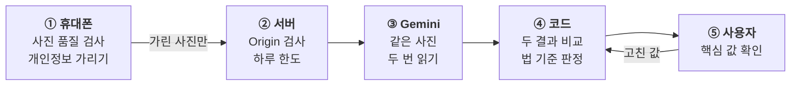

<div align="center">

# contract-check

**사진 한 장으로 확인하는 청년 근로·외주 계약서 점검 서비스**

서명하기 전에, 계약서 속 불리한 조항과 빠진 항목을 휴대폰으로 확인합니다.

[](https://contract-check.zipry1.workers.dev)


[시연](https://contract-check.zipry1.workers.dev) · [설계 원칙](#설계-원칙) · [구조](#구조) · [정확도](#정확도) · [실행](#직접-실행하기)

<sub>2026 대한민국 청년 CAREER FAIR AI 해커톤 제출 · 배포 버전 <code>v=20261123q</code> · 로그인 없이 실행</sub>

</div>

<br>

## 한눈에 보기

<table>
<tr>
<td align="center"><h2>98.3%</h2>읽기 정확도</td>
<td align="center"><h2>0.4%</h2>표시 없는 오답</td>
<td align="center"><h2>0장</h2>서버 저장 사진</td>
<td align="center"><h2>$0.0059</h2>1건 분석 비용</td>
</tr>
</table>

<sub>정확도·오답률: 근로계약서 33개 항목, 가상 계약서 사진 109장(3,597칸) 측정. 표시 없이 틀린 값은 한 번 읽을 때(0.8~0.9%)의 절반 이하입니다. 사진은 휴대폰에서 개인정보를 가린 뒤에만 보내고 서버에 저장하지 않습니다. 비용은 외주 계약서 1개를 두 번 읽은 평균입니다. 자세한 조건은 [정확도](#정확도)에 있습니다.</sub>

<br>

## 기능

- **근로계약서 점검** — 사진·PDF(최대 3장)를 올리면 33개 항목을 읽고, 위험·주의·참고로 나눠 근거 조문과 대응 방법을 보여 줍니다.
- **외주 계약서 비교** — 계약서 1~3개를 표준계약서 기준(납품형 13항목, 권리형 16항목)과 나란히 비교합니다.
- **법 안내** — 주제 카드 10개와 조문 원문 62개. 카드마다 확인일을 표시합니다.
- **AI 질문** — 등록된 조문 안에서만 답합니다(근거 제한형). 근거가 없으면 상담 창구(1350 등)로 안내합니다.
- **커뮤니티** — 로그인 없이 닉네임과 글 비밀번호로 경험을 나눕니다. AI는 쓰지 않습니다.

<br>

## 설계 원칙

> **AI는 읽기만 합니다. 판정은 코드가, 최종 확인은 사람이 합니다.**

| 단계 | 하는 일 |
|:--|:--|
| **1. 가리기**<br><sub>휴대폰</sub> | 개인정보를 휴대폰 안에서 가립니다. 원본 사진은 밖으로 나가지 않고, 하나도 가리지 않으면 분석을 막습니다. |
| **2. 읽기**<br><sub>AI (Gemini)</sub> | 사진 속 글자를 항목별 값으로 바꾸는 일만 합니다. |
| **3. 검증**<br><sub>코드</sub> | 같은 사진을 프롬프트 2개로 동시에 읽고, 값이 다르거나 규칙에 어긋나면 '확인 필요'를 붙입니다. |
| **4. 확인**<br><sub>사용자</sub> | 시급·근로시간 같은 핵심 값을 원본과 맞춰 보고 고칩니다. |
| **5. 판정**<br><sub>코드</sub> | 판정과 화면 문장은 코드에 고정했습니다. AI가 만든 문장은 결과에 보여 주지 않습니다. |

<br>

## 구조



### 폴더

```text
contract-check/
├─ service/                  배포되는 서비스 (Cloudflare Workers)
│  ├─ public/                휴대폰 웹 화면 — 프레임워크 없는 HTML·CSS·JS
│  ├─ src/                   서버 — API, AI 호출, 하루 한도, 커뮤니티
│  ├─ migrations/            D1 표 구조와 예시 글
│  └─ wrangler.jsonc         배포 설정 (키는 들어 있지 않음)
└─ eval/                     판정 코드와 정확도 측정
   ├─ lib/                   판정·검증 코드 — 서버와 측정 도구가 같은 파일을 씀
   ├─ prompts/               AI 읽기 프롬프트 (c1·c2 근로, f1·f2 외주)
   ├─ tools/                 측정 실행, 법령 원문 대조
   └─ results/               측정 결과 보고서
```

### API

| 경로 | 하는 일 | AI |
|:--|:--|:--:|
| `POST /api/extract` | 근로계약서 사진 두 번 읽기 → 비교 → 판정 | ● |
| `POST /api/judge` | 사용자가 고친 값으로 다시 판정 | |
| `POST /api/fl/extract` | 외주 계약서 두 번 읽기 → 표준계약서 기준과 비교 | ● |
| `POST /api/fl/compare` | 확인을 마친 계약서 1~3개 나란히 비교 | |
| `POST /api/ask` | `laws.json` 안에서만 답하고, 답에 쓴 조문 id를 서버가 대조 | ● |
| `/api/comm/*` | 글·댓글·공감·신고 (비밀번호 PBKDF2, 신고 3회면 숨김) | |
| `GET /api/health` | 상태 확인 | |

### 보호 장치

- 서버는 사진과 질문을 저장하지 않습니다.
- AI 요청과 커뮤니티 쓰기는 이 서비스 화면에서 온 것만 받습니다 (Origin 검사).
- 하루 한도: 분석 전체 600건·접속 주소당 60건, AI 질문 전체 600회·접속 주소당 300회. 접속 주소는 서버 비밀 값을 섞은 해시로만 기록하고 48시간 뒤 지웁니다.
- 모델은 `gemini-3.1-flash-lite`. 응답이 없거나 오류이면 `gemini-3.5-flash-lite`로 다시 시도합니다.

<details>
<summary><b>파일별 역할 자세히 보기</b></summary>

<br>

**화면 · `service/public/`**

| 파일 | 역할 |
|:--|:--|
| `index.html` · `style.css` | 모든 화면 (홈·계약서 점검·법 안내·AI 질문·커뮤니티) |
| `app.js` | 근로계약서 점검: 사진 축소 → 가리기 → `/api/extract` → 값 확인 → 결과 |
| `freelance.js` · `freelance.json` | 외주·연재 계약서 비교 화면과 기준표 |
| `quality.js` | 사진 반사·흐림·어두움 검사 (기준값은 측정 사진 109장으로 정함) |
| `pdfpages.js` · `vendor/pdfjs/` | PDF를 쪽마다 사진으로 바꿈. 휴대폰 안에서만 바꾸고 PDF는 보내지 않음 |
| `pii.js` | 주민등록번호·전화번호·이메일·계좌번호 형식 찾기 (화면과 서버가 같이 씀) |
| `learn.js` · `laws.json` | 법 안내 데이터. AI 질문의 근거 자료와 같은 파일 |
| `ask.js` · `comm.js` | AI 질문, 커뮤니티 화면 |
| `privacy.html` · `policy.html` | 개인정보 처리방침, 커뮤니티 운영정책 |
| `samples/` | 시연용 가상 계약서 사진 (실제 개인정보 없음) |

**서버 · `service/src/`**

| 파일 | 역할 |
|:--|:--|
| `index.js` | 요청 나누기, Origin 검사, 하루 한도, 근로계약서 읽기·판정, 매일 03:00 사용량 기록 정리 |
| `freelance.js` | 외주·연재 계약서 읽기·비교 |
| `ask.js` | 근거 제한형 AI 질문 |
| `comm.js` | 커뮤니티 |

**판정·검증 · `eval/lib/`**

| 파일 | 역할 |
|:--|:--|
| `contract.js` | 근로계약서 33개 항목 정의, AI 출력 양식, 값 비교 |
| `crosscheck.js` | 두 번 읽기 비교 + 규칙 검사 (날짜 순서, 임금 형태와 금액 자릿수 등) |
| `legal.js` | 법 기준 판정: 최저임금·수습 감액·휴게시간·주 52시간·주휴·가산임금·위약금·포괄임금·필수 기재 사항·서명·사회보험 |
| `freelance.js` | 외주 항목 정의, '표준과 다름' 규칙, 저작권 조항 원문과 정리 결과가 반대인지 검사 |
| `normalize.js` · `common.js` | 값 정리, 글자 오류율 계산, 파일 읽기 |

</details>

<br>

## 정확도

모든 측정은 가상 계약서로 했습니다. 실제 개인정보는 쓰지 않았습니다.

| 대상 | 조건 | 결과 |
|:--|:--|:--|
| 근로계약서 | 8벌 × 사진 109장 (합성 80 + 폰 사진 29), 33항목 | 정확도 **98.3%**, 표시 없이 틀린 값 **0.4%** |
| 외주·연재 계약서 | 6개 × 합성 5조건 (기울어짐·어두움·그림자·구겨짐·흐림) = 30장 | 있음/없음 **435/435**, 표준과 다름 **214/215**, 핵심 숫자 **165/165** |

- 기록: [`eval/results/계약2차/report.md`](eval/results/계약2차/report.md), [`eval/results/10차-합성5조건/_report.txt`](eval/results/10차-합성5조건/_report.txt)
- **한계** — 실제 종이 계약서로는 재지 않았습니다. 실제 손글씨는 메모 7장만 시험했고 정확도는 86.7%였습니다. 그래서 핵심 값은 사용자가 직접 확인하게 했습니다.

<details>
<summary><b>측정·검증 도구</b></summary>

<br>

| 파일 | 역할 |
|:--|:--|
| `eval/evaluate-contract.js` | 근로계약서 읽기 결과를 정답과 비교해 보고서 작성 |
| `eval/tools/make-crosscheck.mjs` | 저장된 두 읽기 결과로 비교·규칙 검사를 다시 계산 (AI 호출 없음) |
| `eval/tools/freelance-run.mjs` | 외주 계약서 읽기 측정 실행·채점 |
| `eval/tools/lawfetch.mjs` · `admrulfetch.mjs` · `lawcheck.mjs` | 국가법령정보센터 원문을 받아 `laws.json` 조문과 대조 |

- 측정에 쓴 사진·정답 파일과 사진 실행기는 넣지 않았습니다. 결과 보고서만 넣었습니다.
- `normalize.js`·`common.js` 등 측정 도구 일부는 해커톤 기간 중(11-11~15) 다른 목적(식품 라벨 인식 평가)으로 만든 범용 코드를 11-18부터 재사용한 것입니다.

</details>

<br>

## 직접 실행하기

```bash
cd service
npm install
npx wrangler d1 migrations apply comm --local
npx wrangler dev
```

`service/.dev.vars` 파일을 만들고 아래 두 값을 적어야 합니다. 이 저장소에는 들어 있지 않습니다.

```ini
GEMINI_API_KEY=발급받은_키
IP_SALT=아무_긴_문자열
```

- 배포: `npx wrangler deploy` (키는 `wrangler secret put GEMINI_API_KEY`로 넣음)
- `wrangler.jsonc`의 D1 `database_id`는 제출자 계정 값입니다. 다른 계정에서 배포하려면 바꿔야 합니다.

<br>

## 외부 자원

| 이름 | 용도 | 라이선스·조건 |
|:--|:--|:--|
| Google Gemini API | 계약서 읽기, AI 질문 | 유료 API |
| Cloudflare Workers · D1 | 서버, 데이터베이스 | Cloudflare 서비스 |
| PDF.js 4.10.38 (Mozilla) | PDF → 사진 변환 | Apache-2.0 |
| Pretendard | 화면 글꼴 (jsDelivr) | SIL OFL 1.1 |
| 국가법령정보센터 | 조문 원문 | 법령은 저작권 보호 대상이 아님 (저작권법 제7조) |
| 표준계약서 (디자인 분야 용역, 만화 연재) | 외주·연재 기준표 | 정부 고시·공개 자료 |

개발 보조 도구로 Claude Code (Anthropic)를 썼습니다. 설계 결정·검증·최종 확인은 팀이 했습니다.
