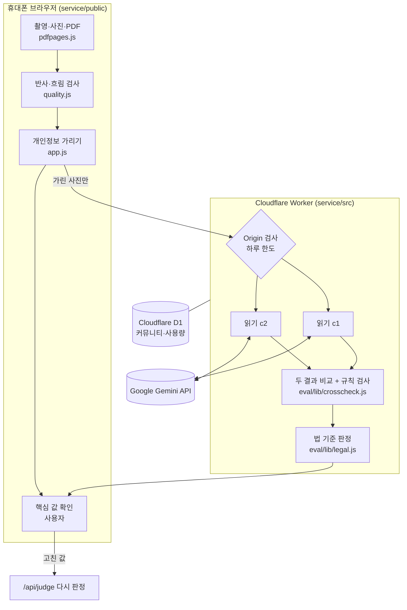

# contract-check — 청년 근로·외주 계약서 점검 서비스

2026 대한민국 청년 CAREER FAIR AI 해커톤 제출용 소스 저장소입니다.
이 저장소에는 배포 중인 서비스 코드(`v=20261123q`)와 정확도 측정 도구가 들어 있습니다.

- **시연 주소:** https://contract-check.zipry1.workers.dev (로그인 없이 실행)
- **기능:** 근로계약서 점검 · 프리랜서(외주·연재) 계약서 비교 · 법 안내 · 근거 제한형 AI 질문 · 커뮤니티

---

## 1. 설계 원칙 — AI는 '읽기'만, 판정은 코드가

| 단계 | 누가 하나 | 왜 |
|---|---|---|
| 개인정보 가리기 | **휴대폰 브라우저** | 원본 사진은 서버나 AI로 보내지 않습니다. 하나도 가리지 않은 사진은 분석을 막습니다. |
| 계약서 읽기 | **AI (Gemini)** | 손글씨·사진 속 글자를 항목별 값으로 바꾸는 일만 합니다. |
| 지어낸 값 잡기 | **코드** | 같은 사진을 프롬프트 2개로 동시에 읽어 두 값이 다르면 '확인 필요'를 붙입니다. 규칙 검사도 함께 합니다. |
| 핵심 값 확인 | **사람(사용자)** | 시급·근로시간 같은 값을 원본과 맞춰 보고 고칩니다. |
| 법 기준 판정·설명 문장 | **코드** | 위험·주의·참고 판정과 화면 문장은 코드에 고정했습니다. AI가 만든 문장은 결과 화면에 보여 주지 않습니다. |

## 2. 전체 구조



### 화면 (`service/public/`) — 프레임워크 없는 HTML·CSS·JavaScript

| 파일 | 역할 |
|---|---|
| `index.html`, `style.css` | 모든 화면(홈·계약서 점검·법 안내·AI 질문·커뮤니티) |
| `app.js` | 근로계약서 점검 흐름: 사진 축소 → 가리기 → `/api/extract` → 값 확인 → 결과 |
| `freelance.js`, `freelance.json` | 프리랜서 계약서 비교 화면과 기준표(납품형 13항목·권리형 16항목) |
| `quality.js` | 사진 반사·흐림·어두움 검사(기준값은 측정 사진 109장으로 정함) |
| `pdfpages.js`, `vendor/pdfjs/` | PDF를 쪽마다 사진으로 바꿉니다. 휴대폰 안에서만 바꾸고 PDF 파일은 보내지 않습니다(PDF.js 4.10.38, Apache-2.0). |
| `pii.js` | 주민등록번호·전화번호·이메일·계좌번호 형식 찾기. AI 질문·커뮤니티에서 쓰고, 서버도 같은 파일을 씁니다. |
| `learn.js`, `laws.json` | 법 안내: 주제 카드 10개, 조문 원문 62개, 카드마다 확인일. AI 질문의 근거 자료와 같은 파일입니다. |
| `ask.js` | AI 질문 화면 |
| `comm.js` | 커뮤니티 화면 |
| `privacy.html`, `policy.html` | 개인정보 처리방침, 커뮤니티 운영정책 |
| `samples/` | 시연용 가상 계약서 사진(실제 개인정보 없음) |

### 서버 (`service/src/`) — Cloudflare Workers

| 경로 | 파일 | 하는 일 | AI 사용 |
|---|---|---|---|
| `POST /api/extract` | `index.js` | 근로계약서 사진(1~3장)을 두 번 읽기 → 비교 → 판정 | ○ |
| `POST /api/judge` | `index.js` | 사용자가 고친 값으로 다시 판정 | × |
| `POST /api/fl/extract` | `freelance.js` | 프리랜서 계약서 1개를 두 번 읽기 → 표준계약서 기준과 비교 | ○ |
| `POST /api/fl/compare` | `freelance.js` | 확인을 마친 계약서 1~3개 나란히 비교 | × |
| `POST /api/ask` | `ask.js` | `laws.json` 안에서만 답하고, 답에 쓴 조문 id를 서버가 등록 목록과 대조. 근거가 없으면 '답하기 어려움'과 상담 창구 안내 | ○ |
| `/api/comm/*` | `comm.js` | 글·댓글·공감·신고. 비밀번호는 PBKDF2로 저장, 신고 3회면 숨김 | × |
| `GET /api/health` | `index.js` | 상태 확인 | × |
| (매일 03:00) | `index.js` | 48시간 지난 사용량 기록 삭제 | × |

- 서버는 사진과 질문을 저장하지 않습니다.
- AI를 부르는 요청과 커뮤니티 쓰기는 이 서비스 화면에서 온 것만 받습니다(Origin 검사).
- 하루 한도(`wrangler.jsonc`): 분석 전체 600건·접속 주소당 60건, AI 질문 전체 600회·접속 주소당 300회. 접속 주소는 서버 비밀 값을 섞은 해시로만 기록합니다.
- 모델: `gemini-3.1-flash-lite`. 응답이 없거나 오류이면 `gemini-3.5-flash-lite`로 다시 시도합니다.

### 판정·검증 코드 (`eval/lib/`) — 서버와 측정 도구가 같은 파일을 씁니다

| 파일 | 역할 |
|---|---|
| `contract.js` | 근로계약서 33개 항목 정의, AI 출력 양식(JSON 스키마), 값 비교 |
| `crosscheck.js` | 두 번 읽기 비교 + 규칙 검사(날짜·시간·금액 모순 등) → '확인 필요' 표시 |
| `legal.js` | 법 기준 판정(최저임금·수습 감액·휴게시간·주 52시간·주휴·가산임금·위약금·포괄임금·필수 기재 사항·서명·사회보험)과 대응 방법 문장 |
| `freelance.js` | 프리랜서 항목 스키마, '표준과 다름' 규칙, 저작권 조항 원문과 정리 결과가 반대인지 검사 |
| `normalize.js`, `common.js` | 값 정리, 글자 오류율 계산, 파일 읽기 |

### 프롬프트 (`eval/prompts/`)

| 파일 | 쓰는 곳 |
|---|---|
| `c2.txt` / `c1.txt` | 근로계약서 본 읽기 / 검증용 읽기 |
| `f2.txt` / `f1.txt` | 프리랜서 계약서 본 읽기 / 검증용 읽기 |

## 3. 정확도 측정 (모두 가상 계약서, 실제 개인정보 없음)

| 대상 | 조건 | 결과 | 기록 |
|---|---|---|---|
| 근로계약서 | 8벌 × 사진 109장(합성 80 + 화면을 찍은 폰 사진 29), 33항목 = 3,597칸 | 정확도 98.3%, **표시 없이 틀린 값 0.4%** (한 번 읽기 0.8~0.9%) | `eval/results/계약2차/report.md` |
| 프리랜서 계약서 | 6개 × 합성 5조건 = 30장 | 있음/없음 435/435, 표준과 다름 214/215, 핵심 숫자 165/165 | `eval/results/10차-합성5조건/_report.txt` |

- 비용: 프리랜서 계약서 1개(두 번 읽기) 평균 약 $0.0059(측정 기록의 실제 토큰 × 공식 단가).
- 한계: 실제 종이 계약서로는 재지 않았습니다. 실제 손글씨는 메모 7장만 시험했습니다(정확도 86.7%). 그래서 핵심 값은 사용자가 확인하게 했습니다.

### 측정·검증 도구 (`eval/`)

| 파일 | 역할 |
|---|---|
| `evaluate-contract.js` | 근로계약서 읽기 결과를 정답과 비교해 보고서 작성 |
| `tools/make-crosscheck.mjs` | 저장된 두 읽기 결과로 비교·규칙 검사를 다시 계산(AI 호출 없음) |
| `tools/freelance-run.mjs` | 프리랜서 계약서 읽기 측정 실행·채점 |
| `tools/lawfetch.mjs`, `tools/admrulfetch.mjs`, `tools/lawcheck.mjs` | 국가법령정보센터 원문을 받아 `laws.json` 조문과 대조 |

- 측정에 쓴 사진·정답 파일과 사진 실행기는 이 저장소에 넣지 않았습니다. 측정 결과 보고서만 넣었습니다.
- `normalize.js`·`common.js` 등 측정 도구 일부는 해커톤 기간 중(11-11~15) 다른 목적(식품 라벨 인식 평가)으로 만든 범용 코드를 11-18부터 재사용한 것입니다.

## 4. 직접 실행하기

```bash
cd service
npm install
# service/.dev.vars 파일을 만들고 아래 두 값을 적습니다(이 저장소에는 없음)
#   GEMINI_API_KEY=...
#   IP_SALT=아무 긴 문자열
npx wrangler d1 migrations apply comm --local
npx wrangler dev
```

- 배포는 `npx wrangler deploy`로 합니다. 배포용 키는 `wrangler secret put GEMINI_API_KEY`로 넣습니다.
- `wrangler.jsonc`의 D1 `database_id`는 제출자의 Cloudflare 계정 값입니다. 다른 계정에서 배포하려면 바꿔야 합니다.

## 5. 외부 자원

| 이름 | 용도 | 라이선스·조건 |
|---|---|---|
| Google Gemini API | 계약서 읽기, AI 질문 | 유료 API |
| Cloudflare Workers · D1 | 서버, 데이터베이스 | Cloudflare 서비스 |
| PDF.js 4.10.38 (Mozilla) | PDF → 사진 변환 | Apache-2.0 (`service/public/vendor/pdfjs/LICENSE`) |
| Pretendard | 화면 글꼴(jsDelivr) | SIL OFL 1.1 |
| 국가법령정보센터 | 조문 원문 | 법령은 저작권 보호 대상이 아님(저작권법 제7조) |
| 표준계약서 (디자인 분야 용역, 만화 연재) | 프리랜서 기준표 | 정부 고시·공개 자료 |

- 개발 보조 도구: Claude Code (Anthropic). 설계 결정·검증·최종 확인은 팀이 했습니다.
